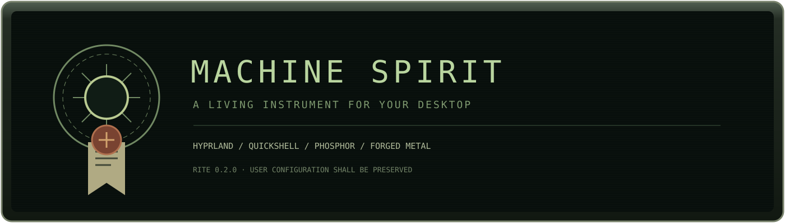
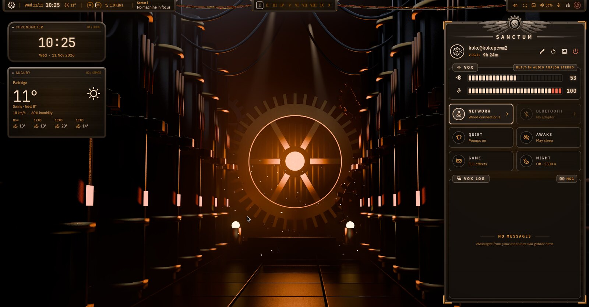
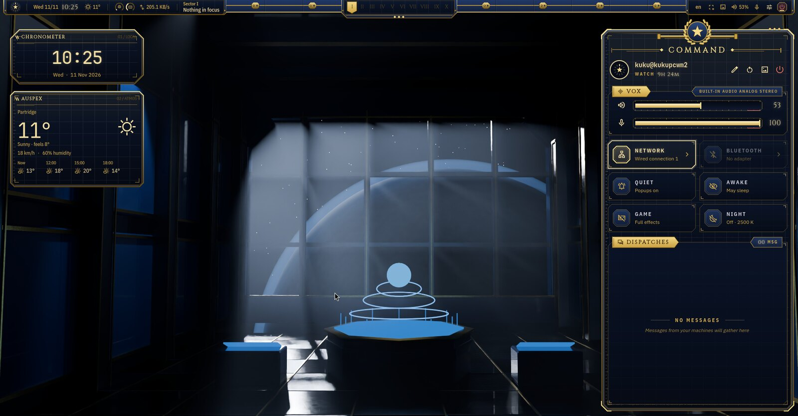
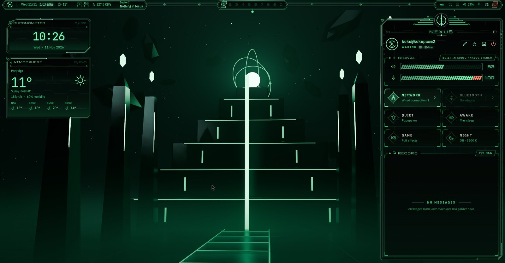
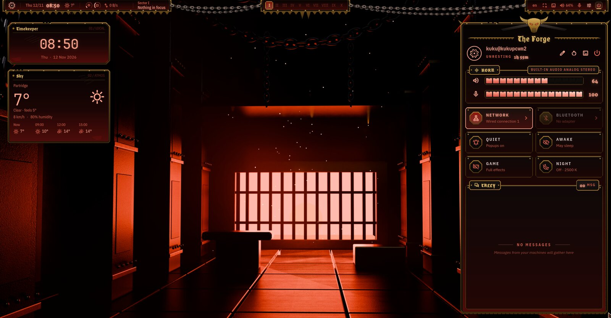
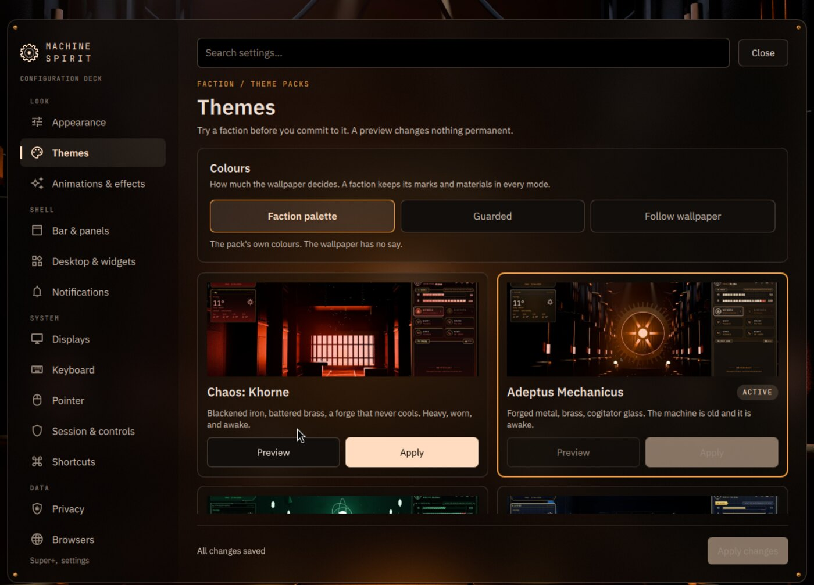

<p align="center"></p>
<p align="center"><b>English</b> · <a href="README.ru.md">Русский</a> · <a href="docs/INSTALL.md">Installation & recovery</a> · <a href="docs/SETTINGS.md">Settings</a> · <a href="docs/KEYBINDINGS.md">Keybindings</a></p>

**MachineSpirit** is a desktop shell for Hyprland, built with Quickshell: phosphor screens, Nixie clocks and machined housings, with colours taken from your wallpaper. Four faction liveries (Adeptus Mechanicus, Ultramarines, Necrons and Khorne) redraw the whole shell and change how it moves, while every control stays where it is. It is an unofficial fan project in the style of Warhammer 40,000.

**0.6.0 · Visual & Motion Overhaul** · Arch Linux / CachyOS · Wayland · [GPL-3.0-only](LICENSE) · Author: [Kukushkasus](https://github.com/Kukushkasus)

<details>
<summary><b>I'm not reading all that. Just give me the install command.</b></summary>

Fine. On Arch Linux or CachyOS, as your normal user (not root, not through `sudo`):

```bash
git clone https://github.com/Kukushkasus/MachineSpirit.git
cd MachineSpirit
./install.sh --full --yes
```

Then reboot and sign in on the login screen with the Hyprland session.

- It works from a plain text console and from a Hyprland session you already run. Nothing that is running gets restarted.
- You need `git`. The installer asks for `sudo` and installs the rest, including the SDDM login screen if you have no login manager yet.
- Your existing files are backed up first. A login manager you already use is left alone.
- Autologin is off by default. The GRUB/Plymouth boot theme is a separate option.
- Details, options and recovery: [Installation and recovery](docs/INSTALL.md).

</details>

<p align="center"></p>
<p align="center"><sub><a href="docs/media/showcase.mp4">Full-quality video (MP4)</a></sub></p>

## Four factions

One shell, four liveries. A theme redraws the bar, housings, glass, controls, popups, the power wheel, the lock screen, the cursor and how windows open. The layout, click areas and readings stay the same. Each faction has its own 4K wallpaper, but picking a theme doesn't touch yours unless you ask.

| Adeptus Mechanicus | Ultramarines |
|---|---|
|  |  |
| **Necrons** | **Chaos: Khorne** |
|  |  |

<p align="center"></p>

Each faction also moves differently: Mechanicus relays snap in and lamps warm up, Ultramarines come up in strict order, Necron panels phase in, Khorne plates drop with weight and throw sparks. More in [Theme packs](docs/THEMES.md).

## What is in it

- **Bar, command console and workspace overview**, the **Sanctum** control desk, popups for time, weather, resources, network and media, a notification log, a wallpaper archive with online sources, and five movable desktop instruments.
- **Settings Center** with fourteen searchable pages: appearance and cursor, themes, bar, widgets, effects, notifications, displays, input, session, shortcuts, privacy, browsers and updates.
- **Theme packs** with a 30-second preview that saves nothing, apply and revert; your own packs as plain data (they cannot run code).
- **Cursors** for every faction, outlined light and dark so they stay visible on any wallpaper; or keep your own.
- **Login, lock and boot** in the same style; reduced-motion and low-power modes; installs and updates with backups.



## Install and update

Requirements: Arch Linux or CachyOS, Hyprland 0.55 or newer with the Lua configuration API, Quickshell (tested with 0.3.2), Python 3.11+ and `pacman`. The quickest way is the box at the top. To choose components or see the plan first:

```sh
./install.sh --full --dry-run
./install.sh --components shell,hyprland,terminal,apps,lock,wallpapers
```

Existing files are backed up and your own edits are kept on update. To update, open **Settings → Updates** or run `ms-update` (it contacts GitHub only when you ask); from a Git checkout, `git pull` and `./install.sh update`. Options, the boot component, existing login managers and recovery: [Installation and recovery](docs/INSTALL.md).

## Compatibility and known limitations

- Developed and tested on Hyprland 0.57 and Quickshell 0.3.2 with a virtual GPU (virtio/virgl). Physical GPUs, NVIDIA and multi-GPU setups have not been tested yet. If you try it on real hardware, please leave an [install report](https://github.com/Kukushkasus/MachineSpirit/issues/new?template=install-report.yml), even if everything worked.
- The faction display faces have no Cyrillic; such text is set in IBM Plex. The interface itself is English.
- Before 1.0 the theme pack format may still change.

## Documentation

- [Installation and recovery](docs/INSTALL.md): requirements, components, updating, backups, rollback and the boot component.
- [Settings](docs/SETTINGS.md): the settings file, cursor, privacy, proxy, browser policies and updates.
- [Theme packs](docs/THEMES.md): the four factions, previews, colour modes and making your own pack.
- [Keybindings](docs/KEYBINDINGS.md) and [desktop instruments](docs/desktop-widgets.md).
- [Contributing](CONTRIBUTING.md), [changelog](CHANGELOG.md) and [third-party credits](THIRD-PARTY.md).

## Inspiration and credits

- [end-4](https://github.com/end-4/dots-hyprland) and [end4-pC](https://github.com/pctrade/end4-pC): desktop workflow, shortcuts, Super-tap handling and motion references.
- [DMS / DUX](https://github.com/duxlabs-dev/dux-shell): early panel and animation references.
- [Noctalia](https://github.com/noctalia-dev/noctalia-shell): settings organization and navigation.
- [Caelestia](https://github.com/caelestia-dots/caelestia): installation, configuration and clock typography references.

Built with Hyprland, Quickshell and Matugen. Warhammer 40,000 and Adeptus Mechanicus belong to Games Workshop; this project is not affiliated with it.

## License

Copyright (c) 2026 Kukushkasus. [GPL-3.0-only](LICENSE). Third-party credits and font licenses: [THIRD-PARTY.md](THIRD-PARTY.md).

Weather may contact wttr.in and infer location from IP; media artwork lookup may contact iTunes; wallpaper providers are contacted when used; update checks contact GitHub only when you ask. See [settings and network behaviour](docs/SETTINGS.md#first-launch-and-privacy).

<p align="center"><br><sub>Preserve the user's work. Keep the signal clear.</sub></p>
