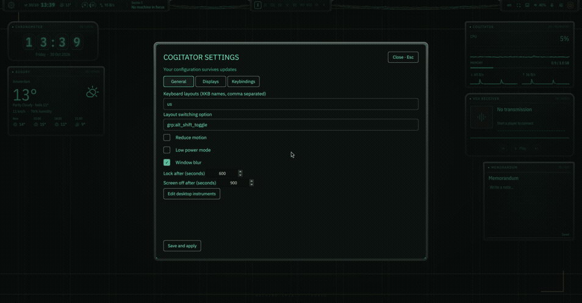
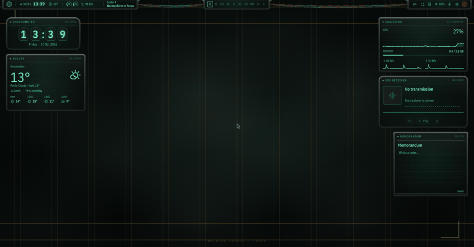
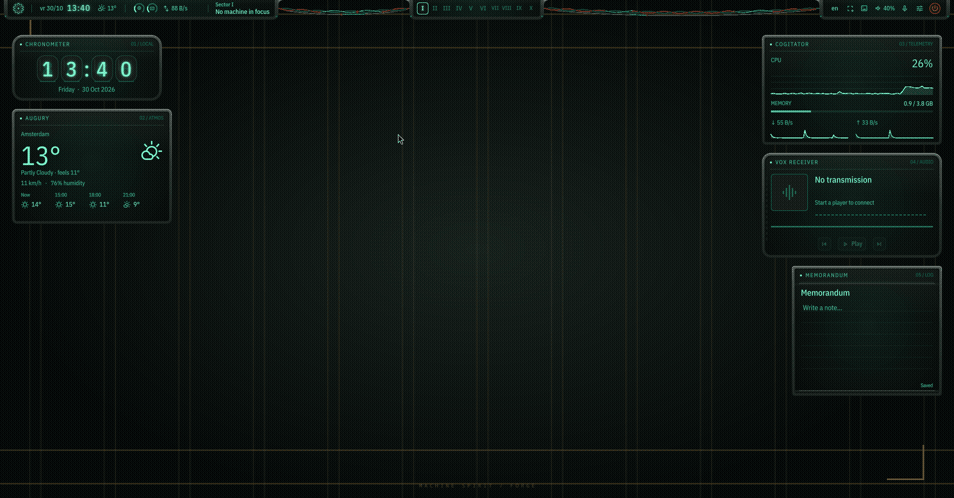

<p align="center"></p>
<p align="center"><a href="README.md">English</a> · <b>Русский</b> · <a href="docs/INSTALL.md">Установка и восстановление</a> · <a href="docs/SETTINGS.md">Настройки</a></p>

> **ПРИБОРЫ ПРОБУЖДАЮТСЯ.**
> Собственная оболочка Hyprland + Quickshell: фосфорные экраны, никси, металлические корпуса и цвета от обоев. Эстетика техножрецов с работающими повседневными инструментами.

**0.1.0-beta.1** · Arch / CachyOS · Wayland · [MIT](LICENSE)

Автор: [Kukushkasus](https://github.com/Kukushkasus).


| Панели | Настройки |
|---|---|
|  |  |



Пять перемещаемых приборов: часы, погода, ресурсы, медиаплеер и заметки. Есть launcher, обзор рабочих столов, уведомления, управление системой, обои и блокировка.

**Super+/** открывает справку по сочетаниям, **Super+,** настройки, **Super+Alt+W** редактор виджетов. По умолчанию интерфейс английский и раскладка `us`; дополнительные раскладки добавляются в настройках. Основной монитор закрепляется за выходом, смена режимов требует подтверждения за 15 секунд.

### Установка

Скачай или клонируй репозиторий и запусти из его папки:

```sh
./install.sh
```

Установщик предлагает отдельные компоненты и полную установку. Перед изменениями можно посмотреть план:

```sh
./install.sh --full --dry-run
./install.sh --components shell,hyprland,terminal,apps,lock,wallpapers
```

Прочитай [инструкцию установки и восстановления](docs/INSTALL.md). Файлы резервируются, обнаруженные пользовательские правки сохраняются. Компонент загрузки пока рассчитан на GRUB + mkinitcpio без действующего display manager. На неподдерживаемой конфигурации он останавливается. Сам установщик запускается обычным пользователем; sudo используется для пакетов и системных изменений.

### Откуда взялись идеи

Эстетическое направление: Warhammer 40,000 и Adeptus Mechanicus. Привычные сценарии и сочетания: [end-4](https://github.com/end-4/dots-hyprland). Ранний ориентир тональных панелей и переходов: [DMS/DUX](https://github.com/duxlabs-dev/dux-shell). Подходы к установке и компонентам: [Caelestia](https://github.com/caelestia-dots/caelestia) и установщики перечисленных оболочек.

Основа: Hyprland, Quickshell и Matugen. Это неофициальный фан-проект без связи с Games Workshop. Обои и графика README созданы для проекта. Зависимости и лицензии перечислены в [THIRD-PARTY.md](THIRD-PARTY.md).

[Результаты проверок](docs/VERIFICATION.md) отделяют проверенное от ограничений beta. Обещания работы на любом железе здесь нет. Сетевая активность погоды, обложек и каталога обоев описана в [настройках](docs/SETTINGS.md).

<p align="center"><br><sub>Сохраняй труд пользователя. Береги сигнал.</sub></p>
