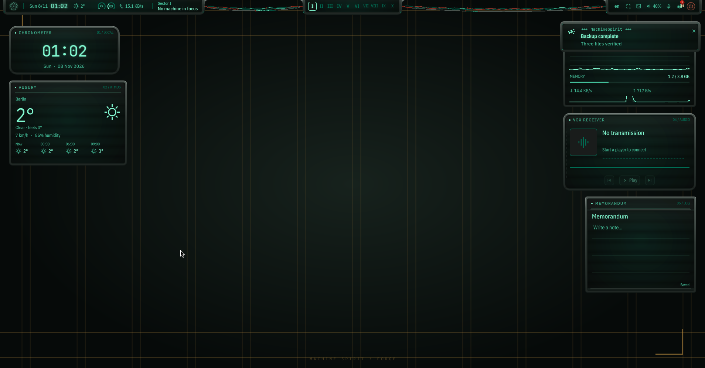

<p align="center"></p>
<p align="center"><a href="README.md">English</a> · <b>Русский</b> · <a href="docs/INSTALL.md">Установка и восстановление</a> · <a href="docs/SETTINGS.md">Настройки</a> · <a href="docs/KEYBINDINGS.md">Сочетания клавиш</a></p>

**MachineSpirit** — оболочка рабочего стола для Hyprland на Quickshell: фосфорные экраны, никси, металлические корпуса и цвета от обоев. Неофициальный фан-проект в эстетике техножрецов Warhammer 40,000.

**0.1.0** · Arch Linux / CachyOS · Wayland · [GPL-3.0-only](LICENSE) · Автор: [Kukushkasus](https://github.com/Kukushkasus)

В простое в тестовой ВМ (4 vCPU): около 2-3% CPU и 600 МиБ RAM.

<p align="center"></p>

## Скриншоты




## Возможности

- Командная консоль с обзором рабочих столов, панель управления (Sanctum), архив уведомлений и браузер обоев.
- Пять перемещаемых приборов: часы, погода, ресурсы, медиаплеер и постоянные заметки.
- Девять разделов настроек с поиском: предпросмотр окон, расположение мониторов с автоматическим откатом, мышь, запись сочетаний и обновления. Несохранённые изменения защищены.
- Мастер первого запуска: пресеты приватности, разрешения сети по функциям, необязательный прокси с авторизацией. Изменения политик браузеров идут отдельно: предпросмотр, авторизация администратора и восстановление.
- Цвета обоев передаются оболочке и выбранным компонентам. Короткие переходы, режимы reduced motion и low power. Экран блокировки и необязательная тема загрузки Plymouth.
- **Super+/** открывает справку по сочетаниям, **Super+,** настройки, **Super+Alt+W** редактор приборов. Интерфейс на английском, раскладки клавиатуры настраиваются.

## Требования

Arch Linux или CachyOS, Hyprland 0.55+ с Lua-конфигурацией (проверено на 0.57), Quickshell (проверено на 0.3.2), Python 3.11+ и `pacman`. Подробности в [инструкции установки](docs/INSTALL.md#requirements).

## Установка

Скачай или клонируй репозиторий и запусти из его папки:

```sh
./install.sh
```

Установщик предлагает отдельные компоненты и полную установку. Перед изменениями можно посмотреть план:

```sh
./install.sh --full --dry-run
./install.sh --components shell,hyprland,terminal,apps,lock,wallpapers
```

Файлы резервируются, твои правки при обновлении сохраняются. Компонент загрузки рассчитан на GRUB с mkinitcpio без менеджера входа и перед изменениями спрашивает подтверждение. `sudo` нужен для пакетов, сам установщик запускается обычным пользователем. AUR не обязателен. Прочитай [установку и восстановление](docs/INSTALL.md) до начала.

## Обновление

Открой **Settings, Updates** или запусти `ms-update`: новая версия проверяется только по твоей просьбе, показывается список изменений, установка идёт с резервными копиями. Из клона Git: `git pull` и `./install.sh update`. См. [раздел об обновлении](docs/INSTALL.md#updating).

## Настройка

Настройки лежат в `~/.config/machinespirit/settings.json` (или в соответствующем XDG-каталоге); интерфейс и файл описывают одни и те же параметры. Обновления сохраняют раскладки, настройки мониторов и заметки. Изменения мониторов подтверждаются в течение 15 секунд, иначе откатываются отдельным процессом.

```json
{
  "version": 1,
  "layouts": ["us", "ru"],
  "primaryOutput": "DP-1"
}
```

## Документация

Руководства пока на английском; ниже, о чём каждое.

| Документ | О чём |
|---|---|
| [Installation and recovery](docs/INSTALL.md) | требования, компоненты, обновление, резервные копии, откат, загрузочный компонент |
| [Settings](docs/SETTINGS.md) | файл настроек, приватность, прокси, политики браузеров, обновления |
| [Keybindings](docs/KEYBINDINGS.md) | все сочетания клавиш |
| [Desktop instruments](docs/desktop-widgets.md) | расстановка виджетов рабочего стола |
| [Contributing](CONTRIBUTING.md), [Changelog](CHANGELOG.md), [Third-party](THIRD-PARTY.md) | участие в проекте, история изменений, сторонние компоненты и лицензии |

## Вдохновение и благодарности

- [end-4](https://github.com/end-4/dots-hyprland) и [end4-pC](https://github.com/pctrade/end4-pC): управление рабочим столом, сочетания клавиш и обработка Super.
- [DMS / DUX](https://github.com/duxlabs-dev/dux-shell): ранние ориентиры для панелей и анимаций.
- [Noctalia](https://github.com/noctalia-dev/noctalia-shell): организация настроек и навигация.
- [Caelestia](https://github.com/caelestia-dots/caelestia): идеи установки, настройки и оформления часов.

Основа: Hyprland, Quickshell и Matugen. Warhammer 40,000 и Adeptus Mechanicus принадлежат Games Workshop; проект с ней не связан.

## Лицензия

Copyright (c) 2026 Kukushkasus. [GPL-3.0-only](LICENSE). Авторы сторонних компонентов и лицензии шрифтов: [THIRD-PARTY.md](THIRD-PARTY.md).

Погода может обращаться к wttr.in и определять место по IP; обложки медиа ищутся через iTunes; поставщики обоев запрашиваются при использовании; проверка обновлений обращается к GitHub только по твоей просьбе. Подробности: [настройки и сетевое поведение](docs/SETTINGS.md#first-launch-and-privacy).

<p align="center"><br><sub>Сохраняй труд пользователя. Береги сигнал.</sub></p>
