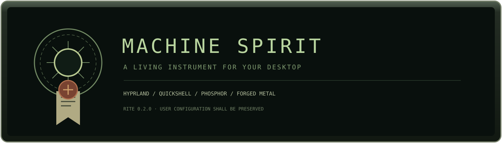
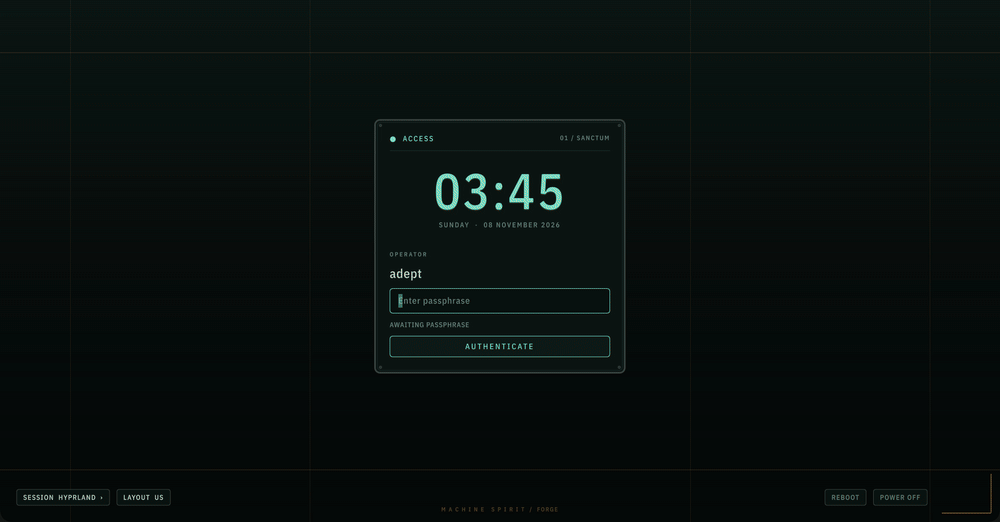
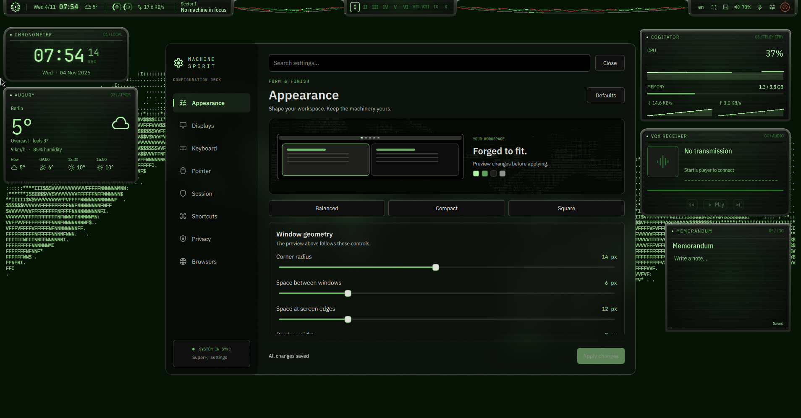
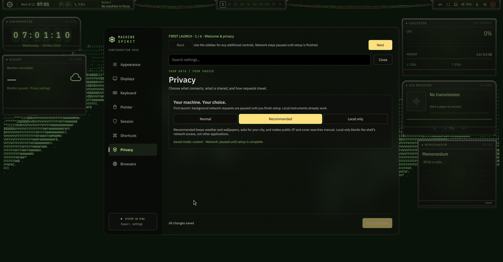

<p align="center"></p>
<p align="center"><a href="README.md">English</a> · <b>Русский</b> · <a href="docs/INSTALL.md">Установка и восстановление</a> · <a href="docs/SETTINGS.md">Настройки</a></p>

> **ПРИБОРЫ ПРОБУЖДАЮТСЯ.**
> Собственная оболочка Hyprland + Quickshell: фосфорные экраны, никси, металлические корпуса и цвета от обоев. Эстетика техножрецов с работающими повседневными инструментами.

**0.1.0-beta.1** · Arch / CachyOS · Wayland · [GPL-3.0-only](LICENSE)

Автор: [Kukushkasus](https://github.com/Kukushkasus).

В простое: **в среднем ~2–3% CPU и ~600 МиБ RAM** в тестовой ВМ (4 vCPU).

<p align="center"></p>



Плавные короткие переходы панелей и элементов управления. Есть режимы reduced motion и low power.

Пять перемещаемых приборов: часы, погода, ресурсы, медиаплеер и заметки. Есть launcher, обзор рабочих столов, уведомления, управление системой, обои и блокировка.

**Super+/** открывает справку по сочетаниям, **Super+,** настройки, **Super+Alt+W** редактор виджетов. По умолчанию интерфейс английский и раскладка `us`; дополнительные раскладки добавляются в настройках. Основной монитор закрепляется за выходом, смена режимов требует подтверждения за 15 секунд.

В настройках теперь восемь разделов с поиском: оформление, мониторы, клавиатура, мышь, сессия, хоткеи, приватность и браузеры. Есть предпросмотр окон, три пресета, настройка отступов и эффектов, запись сочетаний нажатием клавиш и защита несохранённых изменений.

При первом запуске мастер предлагает настройки приватности и сети. Можно выбрать город для погоды, отключить отдельные запросы или всю сеть оболочки, настроить прокси с авторизацией и отдельно применить политики браузеров. Изменения выполняются по выбору пользователя; локальные виджеты продолжают работать. Подробности и ограничения: [настройки](docs/SETTINGS.md#first-launch-and-privacy).



### Установка

Скачай или клонируй репозиторий и запусти из его папки:

```sh
./install.sh
```

Установщик предлагает отдельные компоненты и полную установку. Перед изменениями можно посмотреть план:

```sh
./install.sh --full --dry-run
./install.sh --components shell,hyprland,terminal,apps,lock,wallpapers
```

Прочитай [инструкцию установки и восстановления](docs/INSTALL.md). Файлы резервируются, обнаруженные пользовательские правки сохраняются. Компонент загрузки пока рассчитан на GRUB + mkinitcpio без действующего display manager. На неподдерживаемой конфигурации он останавливается. Сам установщик запускается обычным пользователем; sudo используется для пакетов и системных изменений.

### Вдохновение

- [end-4](https://github.com/end-4/dots-hyprland) и [end4-pC](https://github.com/pctrade/end4-pC): управление рабочим столом, сочетания клавиш и обработка Super.
- [DMS / DUX](https://github.com/duxlabs-dev/dux-shell): ранние ориентиры для панелей и анимаций.
- [Noctalia](https://github.com/noctalia-dev/noctalia-shell): организация настроек и удобство навигации.
- [Caelestia](https://github.com/caelestia-dots/caelestia): идеи установки, настройки и оформления часов.
- Warhammer 40,000 / Adeptus Mechanicus: оформление. Неофициальный фан-проект без связи с Games Workshop.

Основа: Hyprland, Quickshell и Matugen.

### Лицензия

Copyright (c) 2026 Kukushkasus. [GPL-3.0-only](LICENSE). Авторы сторонних компонентов и лицензии шрифтов: [THIRD-PARTY.md](THIRD-PARTY.md).

<p align="center"><br><sub>Сохраняй труд пользователя. Береги сигнал.</sub></p>
